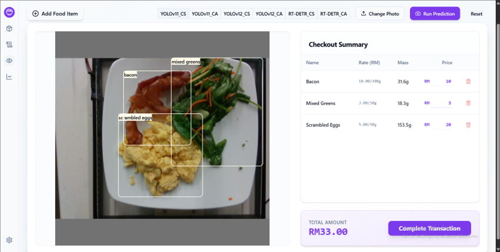
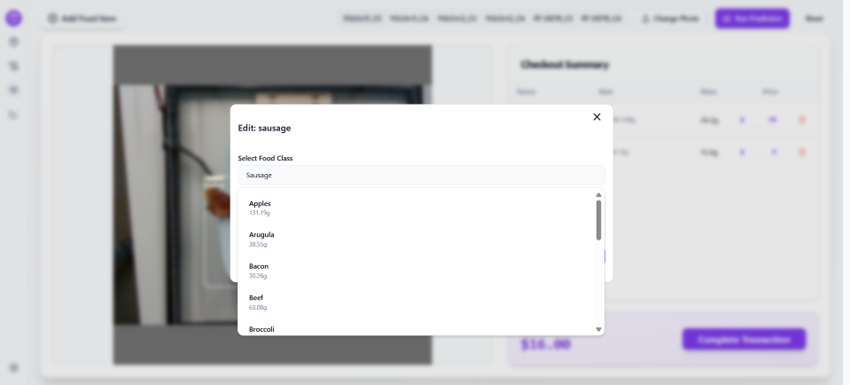
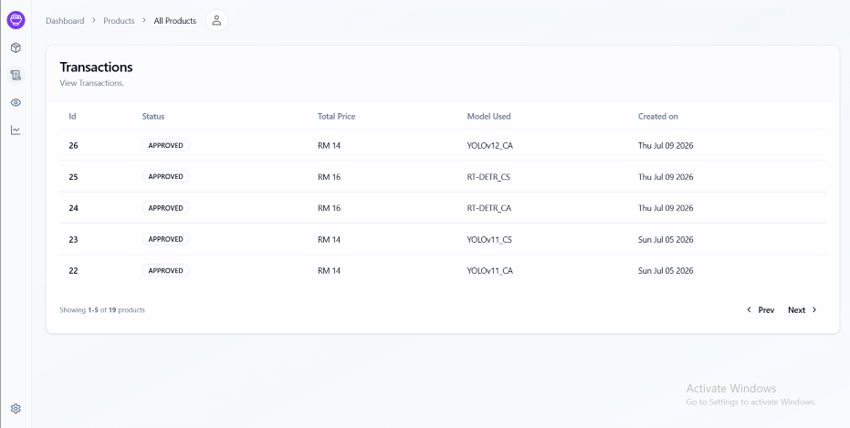
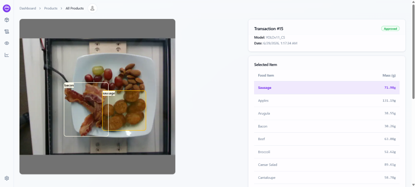
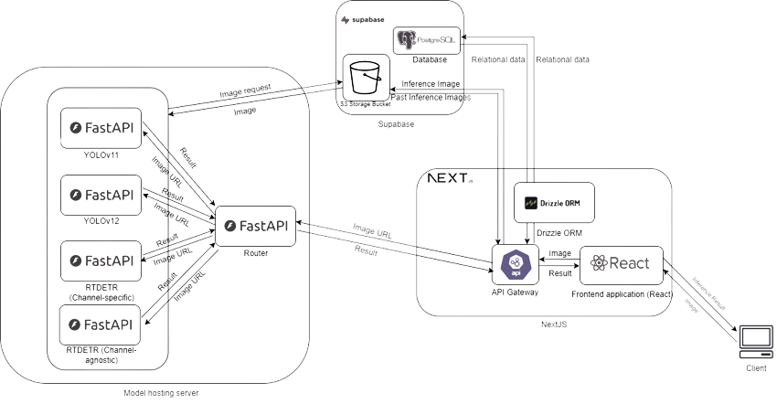
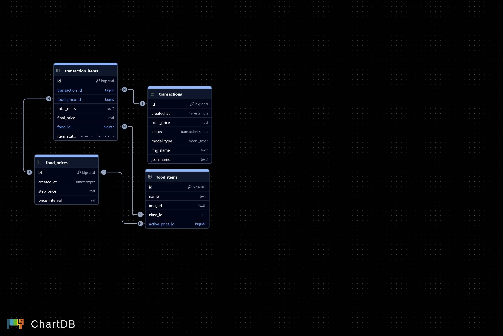

# Mix Rice Detection and Pricing Web App

This system takes a photo of a plate, detects and estimates the mass of each food item on it and prices the plate via a customizable price per mass ruleset. The vendor then reviews the result before checkout.

Final Year Project, Multimedia University (Grade A), Best Presenter Award, CITIC 2026


*Figure 1 Inference Screen*


*Figure 2 Edit Food Class for Channel-Specific Models*


*Figure 3 Transaction History*


*Figure 4 Transaction Detail*

## How It Works


## Repositories
| Repository | What it contains |
|---|---|
| mixed-rice-web-app (this repo) | Next.js dashboard for inference, price management and transactions viewing |
| [mixed-rice-inference-api](https://github.com/npcnamedmax/mixed-rice-inference-api) | FastAPI router that sends each request to the respective model server |
| [mixed-rice-detection-models](https://github.com/npcnamedmax/mixed-rice-detection-models) | mass-regression heads, custom loss and metrics, training |
| [datasetv1](https://github.com/npcnamedmax/datasetv1) | 14 food classes, bounding boxes plus mass labels |

## Features
- Allow inference using 6 different models/configurations, including YOLOv11, YOLOv12 and RT-DETR, each in channel-specific and channel-agnostic versions.
- Each detected item shows its bounding box, confidence, predicted mass and price.
- Allows vendors to change the inference items' prices, food types and/or add/remove food items.
- Automated pricing based on mass, and is customizable and versioned instead of overwritten when modified.
- Each transaction is recorded with the model used, original image and prediction JSON, and is marked approved or rejected.

## Results
**Table 1** Channel-specific models

| Metric        | YOLOv11-l | YOLOv12-l | RT-DETR-l |
|---------------|:---------:|:---------:|:---------:|
| Precision     | 93.67%    | 93.17%    | 92.76%    |
| Recall        | 84.85%    | 86.55%    | 89.33%    |
| F1-score      | 89.04%    | 89.74%    | 91.01%    |
| mAP<sub>50</sub>    | 93.02%    | 92.81%    | 91.24%    |
| mAP<sub>50-95</sub> | 87.33%    | 86.03%    | 81.54%    |
| Mass MAE (g)  | 14.13     | 15.32     | 13.26     |
| Latency (ms)  | 32.8      | 47.3      | 40.9      |

**Table 2** Channel-agnostic models

| Metric        | YOLOv11-l | YOLOv12-l | RT-DETR-l |
|---------------|:---------:|:---------:|:---------:|
| Precision     | 90.77%    | 91.54%    | 92.72%    |
| Recall        | 88.54%    | 88.76%    | 87.03%    |
| F1-score      | 89.64%    | 90.13%    | 89.78%    |
| mAP<sub>50</sub>    | 93.27%    | 92.90%    | 90.06%    |
| mAP<sub>50-95</sub> | 86.30%    | 87.09%    | 80.76%    |
| Mass MAE (g)  | 16.01     | 14.84     | 12.91     |
| Latency (ms)  | 33.5      | 48.4      | 45.6      |

## Tech stack
Next.js 15, React 19, TypeScript, Tailwind CSS, shadcn/ui, Auth.js, Drizzle ORM, PostgreSQL (Supabase), Supabase Storage, FastAPI, Python, PyTorch, Ultralytics

## Database

*Figure 5 Database Schema*

## Running locally
```bash
git clone git@github.com:npcnamedmax/mix-rice-web-app.git
cd mix-rice-web-app
npm install
cp .env.example .env
npx drizzle-kit push
npm run dev
```

Open http://localhost:3000

## Limitations
- This is a prototype, not production ready.
- Inference router URL is hard coded to localhost:8000
- No automated tests

## License
MIT. See LICENSE.md